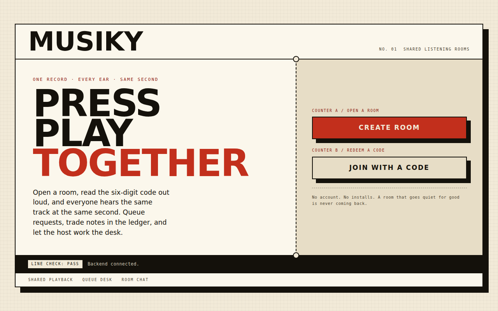
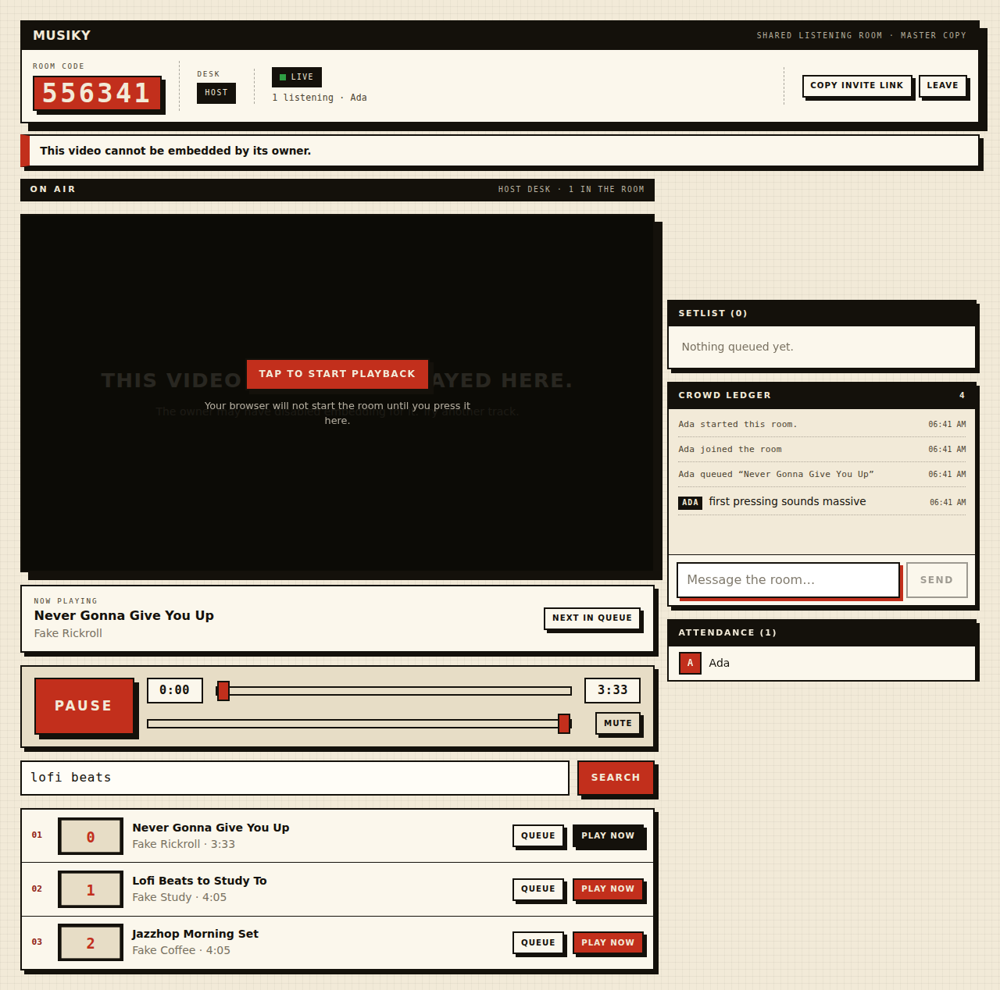

# Musiky — one record, every ear in the room

Musiky is a shared listening room for YouTube music. Open a room, read the
six-digit code out loud, and everyone hears the same track at the same second.
Queue requests, trade notes in the chat, and let the host work the desk.




## Features

- **Shared playback** — server-authoritative play, pause, seek, volume and mute,
  re-synced every 2 seconds with 0.75 s drift tolerance
- **Six-digit rooms** — no accounts, no installs; rooms expire after 6 quiet hours
- **Queue desk** — anyone can queue requests, the host plays them, duplicates refused
- **Host handover** — when the host leaves, the longest-waiting listener is promoted
- **Crowd ledger** — room chat with join/leave/queue announcements
- **Poster-brutalist UI** — paper, ink and one signal red; no two visits look generic

## Tech stack

| Layer    | Tech |
|----------|------|
| Backend  | Flask 3, Flask-SocketIO (threading), MongoDB via PyMongo (or in-memory mock) |
| Search   | YouTube Data API v3 |
| Frontend | React 18, TypeScript, Vite 6, React Router 7, socket.io-client 4, Bootstrap 5 CSS scaffolding under a custom theme |
| Tests    | In-process backend suite (mongomock); `tsc`, ESLint, `vite build` gates |

## Repository layout

```text
Musiky/
├── Backend/
│   ├── app/            # Flask app: routes, sockets, models, YouTube client
│   ├── tests/          # Backend suite (REST + Socket.IO, runs on mongomock)
│   ├── requirements.txt
│   ├── requirements-dev.txt
│   ├── .env.example
│   └── run.py
├── Frontend/
│   └── frontend-musiky/  # React + TypeScript + Vite app
├── docs/
│   └── screenshots/
├── .github/            # CI, issue/PR templates, Dependabot
├── LICENSE / CONTRIBUTING.md / SECURITY.md
└── README.md
```

## Quickstart

### 1. Backend

```bash
cd Backend
python -m venv venv
source venv/bin/activate          # Windows: venv\Scripts\activate
pip install -r requirements.txt -r requirements-dev.txt
cp .env.example .env              # then fill in YOUTUBE_API_KEY (below)
python run.py                     # serves API + Socket.IO on :5000
```

Get a key at <https://console.cloud.google.com/apis/credentials> (enable
**YouTube Data API v3**) and set `YOUTUBE_API_KEY` in `.env`. Search stays
disabled until the key is configured; rooms, queue, chat and playback work
without it.

No MongoDB at hand? Set `MONGO_MOCK=1` in `.env` for an in-memory database
(used by the test suite; rooms won't persist across restarts).

### 2. Frontend

```bash
cd Frontend/frontend-musiky
npm install
npm run dev                       # http://localhost:5173, proxies /api to :5000
```

The dev server (and `vite preview`) proxies `/api` and `/socket.io` to
`http://localhost:5000`. For a backend on another host, set `VITE_API_URL`
(see `Frontend/frontend-musiky/.env.example`).

## Environment reference

| Variable | Default | Purpose |
|---|---|---|
| `SECRET_KEY` | `dev-secret-change-me` | Flask session secret — change in production |
| `HOST` / `PORT` | `0.0.0.0` / `5000` | Backend bind address |
| `CORS_ORIGINS` | `*` | Allowed origins (comma separated) |
| `MONGO_URI` / `MONGO_DB_NAME` | `mongodb://localhost:27017` / `musiky` | MongoDB connection |
| `MONGO_MOCK` | `0` | `1` = in-memory DB, no `mongod` needed |
| `YOUTUBE_API_KEY` | _(empty)_ | YouTube Data API v3 key (enables search) |
| `YOUTUBE_MAX_RESULTS` | `10` | Search results per query (max 25) |
| `ROOM_CODE_LENGTH` | `6` | Digits per room code |
| `ROOM_TTL_SECONDS` | `21600` | Room expiry (6 h) |
| `ROOM_MAX_PARTICIPANTS` / `ROOM_MAX_QUEUE` | `50` / `100` | Room capacity limits |
| `CHAT_MAX_LENGTH` | `500` | Max characters per message |
| `VITE_API_URL` (frontend) | _(empty)_ | Backend base URL when not using the dev proxy |

## Tests and checks

```bash
# Backend suite — 49 checks, in-process, no MongoDB or YouTube key needed
cd Backend
PYTHONPATH=. MONGO_MOCK=1 python tests/test_api.py

# Frontend gates
cd Frontend/frontend-musiky
npm run lint        # eslint
npx tsc -b          # typecheck
npm run build       # typecheck + production build
```

All three run in CI on every push and pull request (see `.github/workflows/ci.yml`).

## Deployment notes

- Serve the backend with something production-grade (e.g. gunicorn + an
  async worker, or the `run.py` entry behind a reverse proxy) and terminate TLS
  at the proxy.
- Set `SECRET_KEY` and a restrictive `CORS_ORIGINS` — never ship the dev defaults.
- Build the frontend with `npm run build` and serve `dist/` statically; point
  `VITE_API_URL` at the backend, or proxy `/api` + `/socket.io` like the dev server does.
- MongoDB needs a TTL-friendly setup; rooms carry `expires_at` and are refreshed
  on activity.

## Contributing

Bug reports, ideas and pull requests are welcome. Please read
[CONTRIBUTING.md](CONTRIBUTING.md) first — it covers setup, the PR checklist
and the manual room QA pass. Security issues: see [SECURITY.md](SECURITY.md)
— **do not** open a public issue for them.

## License

MIT — see [LICENSE](LICENSE).
